# Slicing UI – Routime

> Panduan elemen antarmuka dan cara penggunaan aplikasi **Routime** (pelacak kebiasaan harian).
> Penugasan Mobile Apps OmahTI 2026 · Repo: https://github.com/irulanam11/routime_OTIMobApps26

**Daftar isi**

1. [Pengenalan Aplikasi](#1-pengenalan-aplikasi)
2. [Halaman Home / Hari Ini](#2-halaman-home--hari-ini)
3. [Halaman Tambah & Edit Habit](#3-halaman-tambah--edit-habit)
4. [Halaman Detail Habit](#4-halaman-detail-habit)
5. [Halaman Timer](#5-halaman-timer-countdown-stopwatch-pomodoro)
6. [Halaman Statistik](#6-halaman-statistik)
7. [Navigasi Aplikasi](#7-navigasi-aplikasi)
8. [Panduan Penggunaan Fitur](#8-panduan-penggunaan-setiap-fitur)
9. [Lampiran: Design Token](#9-lampiran-design-token)

---

## 1. Pengenalan Aplikasi

**Routime** membantu pengguna membangun rutinitas: tambahkan kebiasaan, centang setiap hari, pantau *streak*, dan (opsional) gunakan timer fokus untuk kebiasaan tertentu.

### Fitur utama

| Fitur | Keterangan |
|---|---|
| Daftar kebiasaan harian | Centang selesai/belum, progress ring, streak |
| Tambah / edit / hapus kebiasaan | Nama, deskripsi, warna, opsi timer |
| Detail kebiasaan | Streak saat ini, streak terpanjang, kalender bulanan |
| Timer kebiasaan | Countdown, Stopwatch, Pomodoro + notifikasi |
| Statistik | Ringkasan bulan, kalender konsistensi, grafik mingguan, peringkat habit |
| Responsif & adaptif | Bottom bar di HP, side rail + dua panel di layar lebar |
| Penyimpanan lokal | Data tetap ada setelah aplikasi ditutup |

### Splash Screen

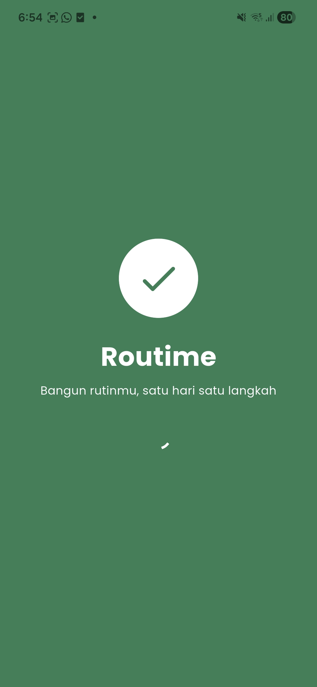

| No | Elemen | Fungsi |
|---|---|---|
| 1 | Latar hijau (`primary`) | Identitas warna aplikasi |
| 2 | Ikon centang dalam lingkaran putih | Logo Routime |
| 3 | Teks "Routime" + tagline *Bangun rutinmu, satu hari satu langkah* | Nama dan slogan aplikasi |
| 4 | Indikator loading melingkar | Menandakan data sedang dimuat |

Animasi: logo muncul dengan efek fade + zoom kecil. Layar tampil minimal 1,8 detik sambil memuat data, lalu berpindah ke halaman utama dengan transisi fade.

---

## 2. Halaman Home / Hari Ini

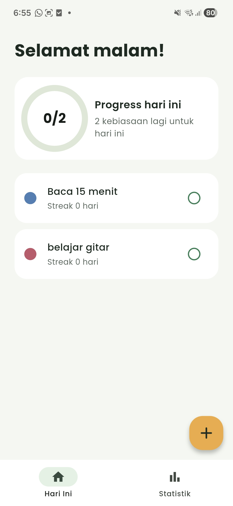

| No | Elemen | Fungsi |
|---|---|---|
| 1 | **Sapaan** ("Selamat pagi/siang/sore/malam!") | Berubah otomatis menurut jam: <11 pagi, <15 siang, <18 sore, selain itu malam |
| 2 | **Kartu progress** | Ringkasan kemajuan hari ini |
| 2a | Progress ring (`2/6`) | Jumlah kebiasaan selesai / total, dianimasikan saat berubah |
| 2b | Teks "Progress hari ini" + pesan | "N kebiasaan lagi untuk hari ini", "Semua kebiasaan selesai hari ini!", atau ajakan menambah kebiasaan pertama |
| 3 | **Kartu kebiasaan** | Satu kartu per habit. Pada layar lebar, kartu yang sedang dipilih diberi bingkai hijau |
| 3a | Titik warna | Warna yang dipilih untuk habit |
| 3b | Nama habit | Judul kebiasaan (satu baris, dipotong dengan "…" jika terlalu panjang) |
| 3c | Teks "Streak X hari" | Rangkaian hari beruntun yang sudah selesai |
| 3d | Tombol centang (lingkaran kosong / ✓) | Menandai selesai atau membatalkan untuk hari ini |
| 4 | **Floating Action Button (+)** kuning | Membuka halaman *Kebiasaan Baru* |
| 5 | **Bottom Navigation Bar** | Pindah antara *Hari Ini* dan *Statistik* |
| 6 | Keadaan kosong | "Belum ada kebiasaan. Tekan + untuk menambah." |

### Interaksi

| Aksi | Hasil |
|---|---|
| Tap tombol centang | Toggle selesai hari ini; progress ring dan streak ikut berubah |
| Tap kartu | HP: buka Detail Habit. Layar lebar: tampil di panel kanan |
| Geser kartu ke kiri | Muncul latar merah + ikon tempat sampah, lalu dialog konfirmasi hapus |

### Dialog Konfirmasi Hapus

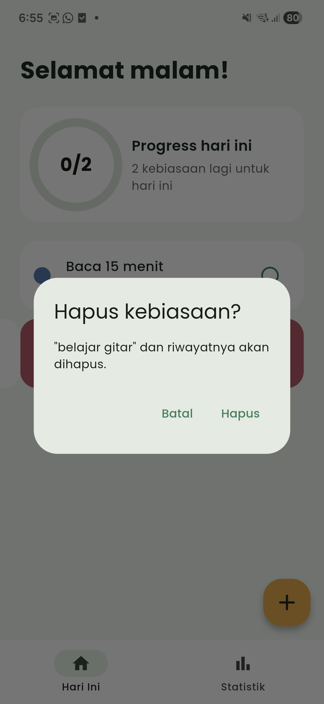

Judul "Hapus kebiasaan?", isi `"<nama>" dan riwayatnya akan dihapus.`, tombol **Batal** (tutup tanpa hapus) dan **Hapus** (hapus habit beserta riwayat dan timer miliknya).

---

## 3. Halaman Tambah & Edit Habit

Satu layar form yang sama dipakai untuk dua mode.

| Mode | Judul AppBar | Tombol bawah | Dibuka dari |
|---|---|---|---|
| Tambah | Kebiasaan Baru | Simpan | FAB (+) di Home |
| Edit | Edit Kebiasaan | Simpan Perubahan | Ikon pensil di Detail Habit |

 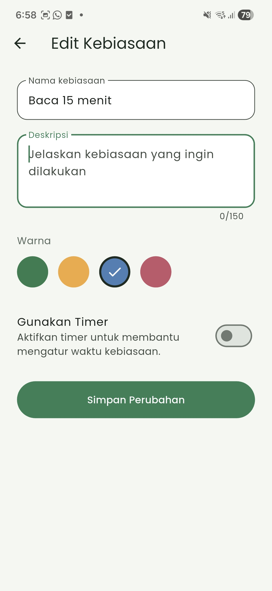

| No | Elemen | Fungsi |
|---|---|---|
| 1 | Tombol kembali (←) | Kembali tanpa menyimpan |
| 2 | Kolom **Nama kebiasaan** | Wajib diisi. Jika kosong muncul pesan "Nama tidak boleh kosong" |
| 3 | Kolom **Deskripsi** + penghitung `0/150` | Keterangan opsional, maksimal 150 karakter |
| 4 | **Pilihan warna** (hijau, kuning, biru, merah) | Lingkaran terpilih diberi tepi gelap dan tanda centang |
| 5 | **Switch "Gunakan Timer"** | Jika aktif, halaman detail habit menampilkan Timer Kebiasaan |
| 6 | Tombol **Simpan / Simpan Perubahan** | Validasi lalu simpan, kembali ke halaman sebelumnya |

---

## 4. Halaman Detail Habit

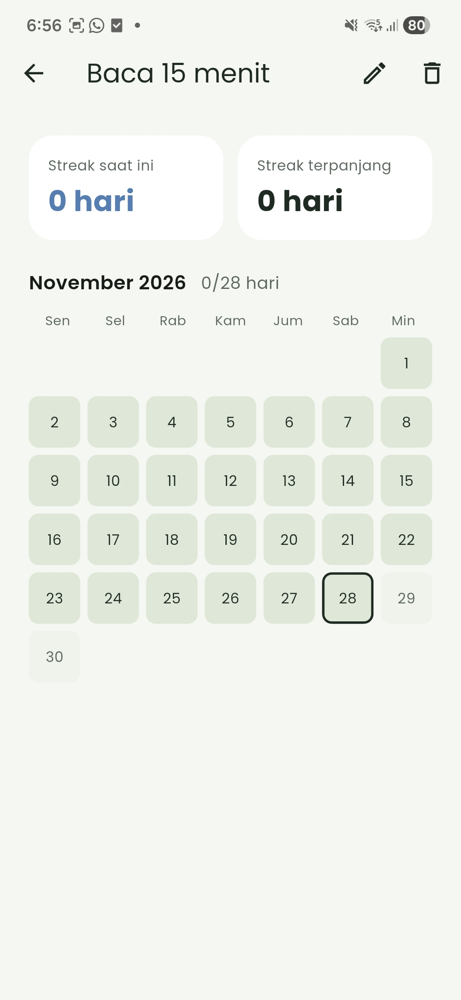 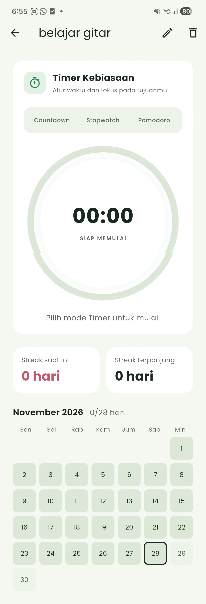

| No | Elemen | Fungsi |
|---|---|---|
| 1 | AppBar: ← , nama habit | Kembali dan judul |
| 2 | Ikon pensil | Membuka form Edit Kebiasaan |
| 3 | Ikon tempat sampah | Dialog konfirmasi lalu hapus habit |
| 4 | **Kartu Timer** (hanya jika "Gunakan Timer" aktif) | Lihat [bagian 5](#5-halaman-timer-countdown-stopwatch-pomodoro) |
| 5 | Kartu **Streak saat ini** | Hari beruntun sampai hari ini (hijau/warna habit) |
| 6 | Kartu **Streak terpanjang** | Rekor hari beruntun terpanjang |
| 7 | Judul bulan + `x/y hari` | Contoh "November 2026" dan "1/26 hari" (selesai / hari yang sudah lewat) |
| 8 | Baris nama hari (Sen–Min) | Header kalender, minggu dimulai Senin |
| 9 | **Kalender bulan ini** | Satu kotak per tanggal |

### Arti warna kotak kalender

| Tampilan | Arti |
|---|---|
| Berwarna penuh (warna habit) | Hari itu selesai |
| Hijau pucat | Hari yang sudah lewat tetapi belum selesai |
| Abu sangat muda, teks abu | Tanggal yang belum tiba |
| Berbingkai gelap tebal | Hari ini |

---

## 5. Halaman Timer (Countdown, Stopwatch, Pomodoro)

Timer muncul di bagian atas Detail Habit, hanya untuk habit dengan opsi timer aktif.

!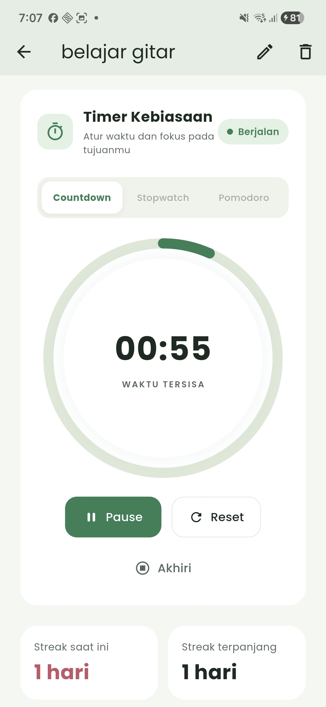 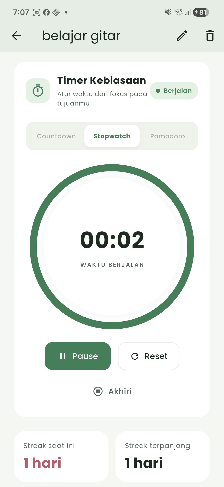 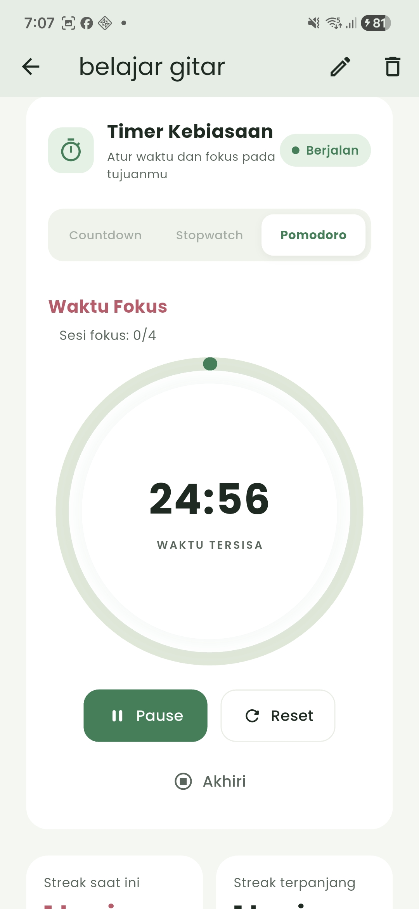

### Elemen kartu Timer

| No | Elemen | Fungsi |
|---|---|---|
| 1 | Ikon timer + judul **Timer Kebiasaan** + subjudul *Atur waktu dan fokus pada tujuanmu* | Header kartu |
| 2 | **Badge status** (titik + "Berjalan" / "Dijeda") di kanan header | Hanya tampil jika timer ini milik habit yang sedang dibuka. Hijau saat berjalan, kuning saat dijeda |
| 3 | **Pemilih mode** (Countdown / Stopwatch / Pomodoro) | Segmented control; mode terpilih berlatar putih dan bercetak tebal. Tidak bisa ditekan saat timer sedang berjalan |
| 4 | Info Pomodoro (hanya mode Pomodoro) | Nama fase dan "Sesi fokus: x/y" |
| 5 | **Lingkaran progress** berisi waktu `MM:SS` (atau `HH:MM:SS`) | Cincin terisi sesuai progress waktu |
| 6 | Label di bawah waktu | `SIAP MEMULAI` (belum ada timer), `WAKTU TERSISA` (Countdown/Pomodoro), `WAKTU BERJALAN` (Stopwatch) |
| 7 | Teks bantuan | "Pilih mode Timer untuk mulai." saat belum ada timer |
| 8 | Tombol **Pause / Lanjutkan** | Menjeda atau melanjutkan. Berubah menjadi tombol nonaktif **Waktu Habis** (Countdown) atau **Selesai** (Pomodoro) saat timer tuntas |
| 9 | Tombol **Reset** | Kembali ke durasi/keadaan awal |
| 10 | Tombol **Akhiri** | Menghentikan dan menghapus timer |

### Mode timer

| Mode | Cara memulai | Perilaku |
|---|---|---|
| **Countdown** | Pilih mode, isi dialog *Atur Countdown* (durasi menit, bawaan 25) | Hitung mundur; cincin terisi seiring waktu berjalan; saat 0 tombol menjadi "Waktu Habis" dan notifikasi muncul |
| **Stopwatch** | Pilih mode, langsung berjalan | Menghitung waktu naik; cincin penuh; tanpa notifikasi selesai |
| **Pomodoro** | Pilih mode, isi dialog *Pengaturan Pomodoro* | Bergantian fokus dan istirahat; cincin mengikuti progress fase yang sedang berjalan |

### Dialog pengaturan

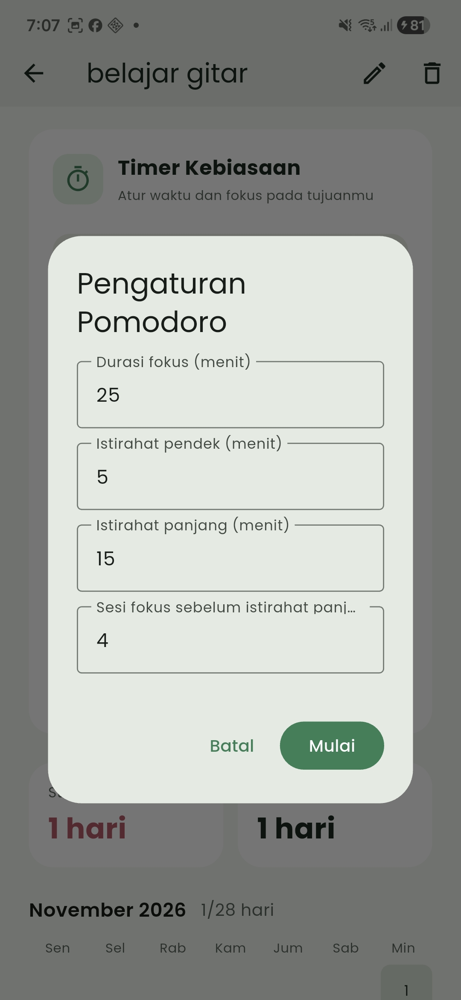

| Dialog | Isian (bawaan) |
|---|---|
| Atur Countdown | Durasi (menit): 25 |
| Pengaturan Pomodoro | Durasi fokus 25 menit · Istirahat pendek 5 menit · Istirahat panjang 15 menit · Sesi fokus sebelum istirahat panjang 4 |

Semua angka harus bilangan bulat lebih dari 0; jika tidak, muncul pesan "Masukkan angka yang valid dan lebih dari 0.". Tombol **Batal** menutup dialog, **Mulai** menjalankan timer.

### Fase Pomodoro

`Waktu Fokus` → `Istirahat Pendek` (berulang) → setelah jumlah sesi tercapai `Istirahat Panjang` → `Pomodoro Selesai`. Penghitung "Sesi fokus: x/y" menampilkan sesi yang sudah selesai.

### Tampilan terkunci

Jika habit lain sedang memakai timer, kartu hanya menampilkan ikon jam bergembok, teks **"Timer sedang digunakan oleh habit lain."**, dan petunjuk untuk membuka habit tersebut lalu menekan **Akhiri**.

### Aturan penting

- **Satu timer aktif untuk satu habit** (lihat tampilan terkunci di atas).
- Mode baru hanya bisa dipilih saat timer **dijeda** atau belum dimulai; saat berjalan, pemilih mode dinonaktifkan.
- Timer **tidak otomatis menyelesaikan habit**; centang tetap dilakukan manual.
- Waktu dihitung dari jam sistem, sehingga tetap akurat setelah aplikasi ditutup lalu dibuka kembali, dan notifikasi lokal dijadwalkan saat timer berjalan.
- Menghapus habit pemilik timer ikut menghapus timernya.

---

## 6. Halaman Statistik

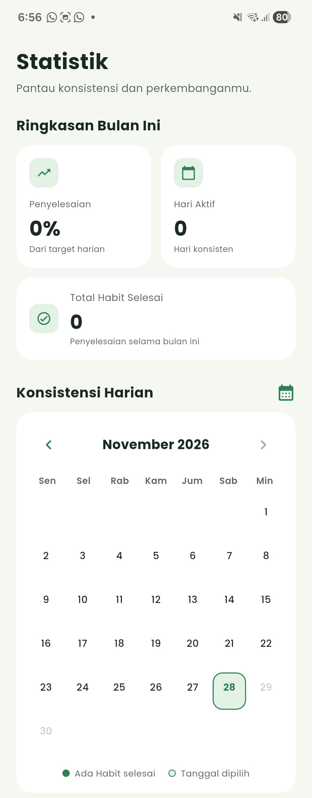 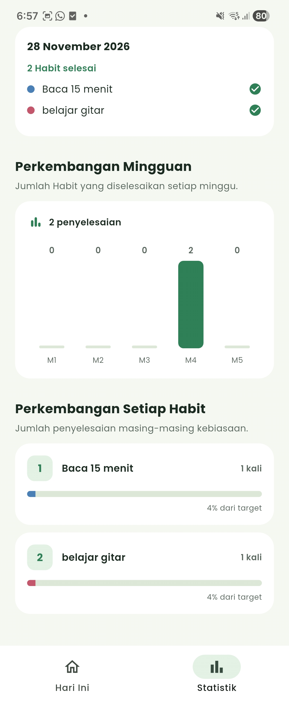

Jika belum ada kebiasaan, halaman menampilkan ikon grafik, judul **"Belum ada data Statistik"**, dan ajakan menambah kebiasaan dulu.

| No | Elemen | Fungsi |
|---|---|---|
| 1 | Judul **Statistik** + subjudul *Pantau konsistensi dan perkembanganmu.* | Header halaman |
| 2 | **Ringkasan Bulan Ini** | Tiga kartu ringkasan untuk bulan yang sedang dipilih di kalender |
| 2a | Kartu *Penyelesaian* (%) | Total penyelesaian ÷ (jumlah habit × jumlah hari yang sudah berlalu di bulan itu) |
| 2b | Kartu *Hari Aktif* | Jumlah tanggal berbeda yang memiliki minimal satu habit selesai |
| 2c | Kartu *Total Habit Selesai* | Jumlah seluruh penyelesaian habit pada bulan itu |
| 3 | **Konsistensi Harian** (kalender) | Kalender bulanan, minggu dimulai Senin |
| 3a | Tombol ‹ › dan nama bulan | Pindah bulan. › nonaktif di bulan berjalan, jadi bulan mendatang tidak bisa dibuka |
| 3b | Titik hijau di bawah tanggal | Menandakan ada habit yang selesai pada tanggal itu |
| 3c | Bingkai hijau pada tanggal | Menandai hari ini |
| 3d | Latar hijau muda pada tanggal | Tanggal yang sedang dipilih |
| 3e | Legenda ("Ada Habit selesai", "Tanggal dipilih") | Penjelasan penanda |
| 4 | **Kartu rincian tanggal** | Menampilkan tanggal terpilih, jumlah habit selesai, dan daftarnya (titik warna, nama, ✓). Jika kosong: "Belum ada Habit yang diselesaikan pada tanggal ini." |
| 5 | **Perkembangan Mingguan** | Diagram batang jumlah penyelesaian per minggu (M1 = tanggal 1-7, M2 = 8-14, dan seterusnya). Tinggi batang relatif terhadap minggu tertinggi, angka tampil di atas batang |
| 6 | **Perkembangan Setiap Habit** | Peringkat habit berdasarkan jumlah penyelesaian bulan itu: nomor urut, nama, "x kali", progress bar berwarna habit, dan "% dari target" |

### Cara membaca

- **Target** adalah satu penyelesaian per hari: persentase = jumlah selesai ÷ hari yang sudah berlalu di bulan tersebut.
- Tanggal yang belum tiba tidak bisa dipilih (teks pudar).
- Berpindah bulan mengatur ulang tanggal terpilih ke tanggal 1 bulan itu.

---

## 7. Navigasi Aplikasi

### Peta layar

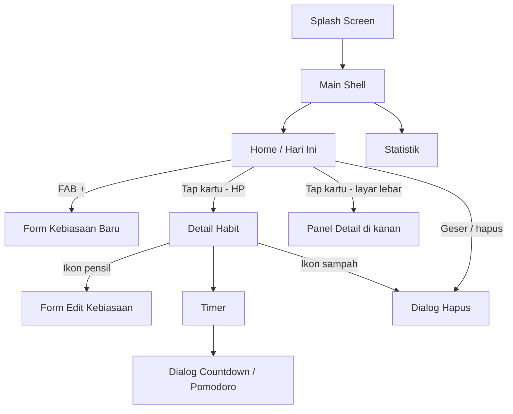

### Jenis navigasi

| Jenis | Digunakan untuk | Kondisi |
|---|---|---|
| `pushReplacement` dengan fade | Splash → Main Shell | Sekali saat start |
| Bottom `NavigationBar` | Hari Ini ↔ Statistik | Lebar < 720 dp (HP) |
| `NavigationRail` di kiri | Hari Ini ↔ Statistik | Lebar ≥ 720 dp (tablet/desktop) |
| `Navigator.push` | Home → Form / Detail, Detail → Edit | Layar bertumpuk, tombol ← untuk kembali |
| Dialog | Konfirmasi hapus, pengaturan timer | Tutup dengan tombol atau gestur kembali |

Halaman utama memakai `IndexedStack`, sehingga posisi scroll dan state tiap tab tetap terjaga saat berpindah tab.

### Layout adaptif

| Lebar layar | Tampilan |
|---|---|
| < 720 dp (HP) | Satu kolom, navigasi bawah, detail di layar terpisah |
| ≥ 720 dp (tablet / desktop) | Navigation rail, daftar habit (410 dp) di kiri dan detail di kanan; konten dibatasi lebar maksimum agar tidak melebar |

---

## 8. Panduan Penggunaan Setiap Fitur

### Menambah kebiasaan
1. Di **Hari Ini**, tekan tombol **+**.
2. Isi **Nama kebiasaan** (wajib) dan **Deskripsi** (opsional).
3. Pilih **warna**.
4. Aktifkan **Gunakan Timer** bila ingin memakai timer.
5. Tekan **Simpan**. Habit muncul di daftar.

### Menandai selesai
1. Di **Hari Ini**, tekan lingkaran di kanan habit hingga berubah ✓.
2. Progress ring dan streak diperbarui. Tekan lagi untuk membatalkan.

### Mengedit kebiasaan
1. Buka habit (tap kartu) → tekan ikon **pensil**.
2. Ubah data, lalu **Simpan Perubahan**.

### Menghapus kebiasaan
- Geser kartu ke kiri **atau** buka detail dan tekan ikon **tempat sampah**, lalu pilih **Hapus**.

### Melihat streak dan kalender
- Buka detail habit untuk melihat streak saat ini, streak terpanjang, dan kalender bulan ini.

### Memakai timer
1. Pastikan habit mengaktifkan **Gunakan Timer** (bisa lewat Edit).
2. Buka detail habit, pilih **Countdown**, **Stopwatch**, atau **Pomodoro**.
3. Atur durasi pada dialog bila diminta, tekan **Mulai**.
4. Gunakan **Pause/Lanjutkan**, **Reset**, atau **Akhiri**.
5. Setelah selesai, kembali ke Home dan centang habit secara manual.

### Membaca statistik
1. Pilih tab **Statistik**.
2. Lihat ringkasan bulan ini, geser kalender dengan ‹ ›, dan pilih tanggal untuk melihat habit yang selesai.
3. Gulir ke bawah untuk grafik mingguan dan peringkat setiap habit.

### Data tersimpan
Seluruh data (habit, riwayat, status timer) disimpan lokal di perangkat dan tidak butuh internet.

---

## 9. Lampiran: Design Token

| Token | Nilai | Penggunaan |
|---|---|---|
| `primary` | `#2F7D4F` | Tombol utama, progress, aksen |
| `accent` | `#F2A83B` | Floating Action Button |
| `background` | `#F4F8F1` | Latar halaman |
| `text` | `#1B2A21` | Teks utama |
| `muted` | `#55665B` | Teks sekunder |
| Warna habit | `#2F7D4F`, `#F2A83B`, `#4A7FB5`, `#C4566B` | Pilihan warna kebiasaan |
| Font | Poppins (Regular, Medium, SemiBold, Bold) | Seluruh teks |
| Sudut kartu | radius 16 | Kartu dan tile |

> **Catatan:** semua gambar berada di folder `images/` (sejajar dengan file ini) dengan nama: `splash_screen`, `home`, `dialog_hapus`, `form_tambah_habit`, `form_edit`, `detail_habit`, `detail_timer`, `timer_countdown`, `timer_stopwatch`, `timer_pomodoro`, `form_timer`, `statistik_atas`, `statistik_bawah` (semuanya `.jpg`).
